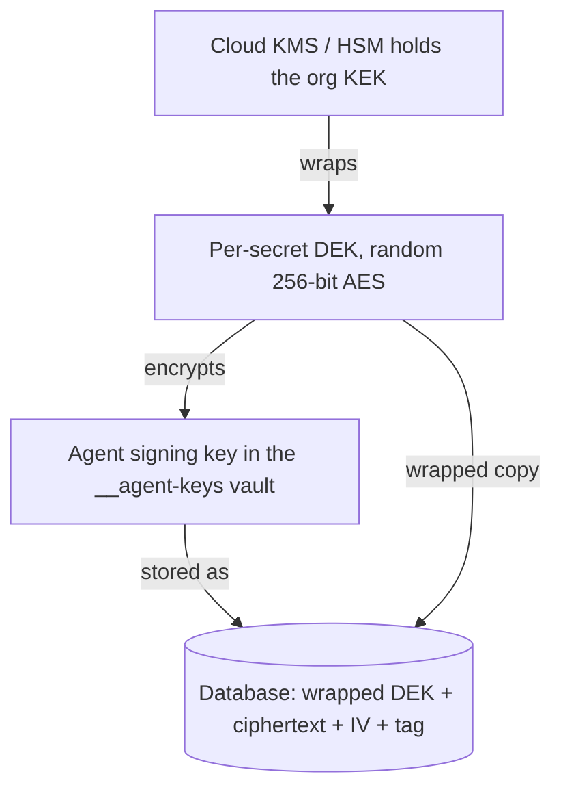
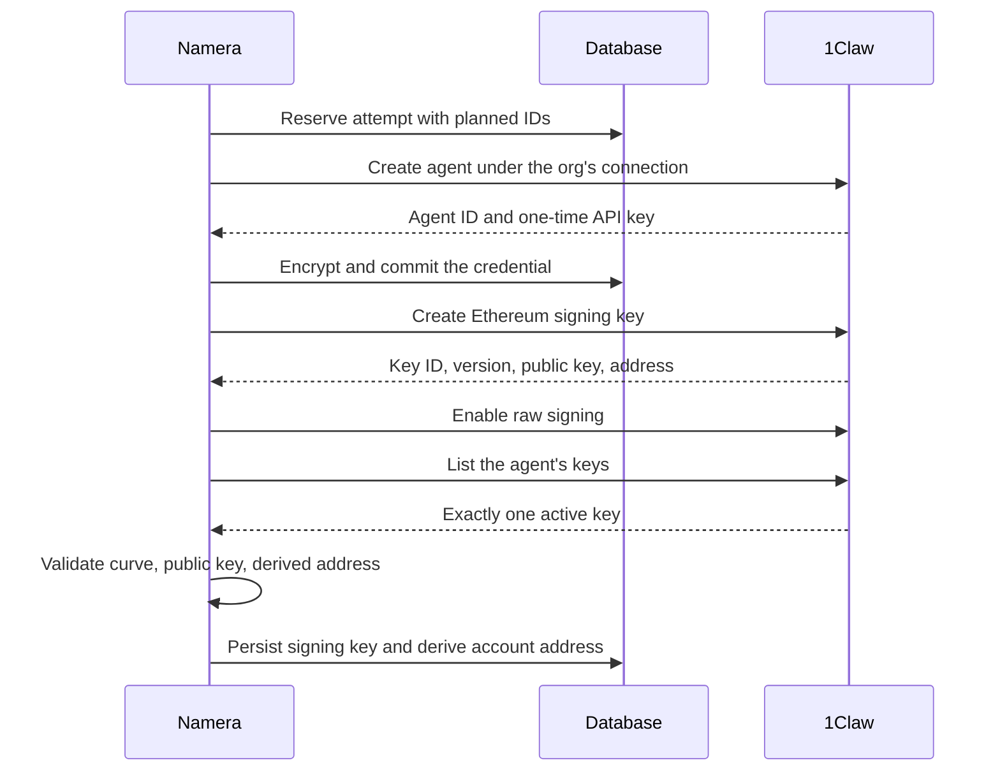

Every Namera account has an owner. The owner is the only identity that can install or remove the onchain permissions an agent runs under. Until now that owner was always a passkey, held by a person, approved through a WebAuthn prompt in the dashboard.

Today there is a second option. An account, or a session key, can be owned by a signing key that lives inside [1Claw](https://1claw.co), an HSM-backed secrets and signing platform built for AI agents. Namera never holds the private key. It asks 1Claw for a signature, verifies what comes back, and submits the operation.

This post explains why we added managed custody, how 1Claw keeps the key, and what Namera does on every signature so that "managed" does not mean "unchecked".

---

## Why Managed Accounts

Passkeys are a strong default. The private key never leaves the authenticator, Namera stores only the public key and credential ID, and every owner approval is something the user sees and confirms. If you are running your own accounts from the dashboard, we still recommend them.

Three situations kept pushing against that model.

**Backends that provision accounts.** A team using the SDK wants an account per customer, or per agent, created from a server. There is no browser open and no person holding a passkey at that moment. Namera supports passkey registration through an API key, but the application still has to run a WebAuthn ceremony with a real user before an account can exist.

**Recovery.** If every copy of a passkey is lost, nobody can approve owner operations for that account. Installed permissions keep working, but nothing can be changed or removed, and funds can end up locked. That is a hard operational problem for a team that just wanted to give an agent a budget.

**Session key custody.** A local session key is a private key held on the agent's machine, encrypted in the OS keyring. That is the right design for a developer running Claude or Codex on a laptop. It is the wrong design for a team that does not want to run a keystore anywhere, and it does not help when the agent runs on infrastructure the team would rather not trust with raw key material.

The answer was a managed signer. The decision was not to build one ourselves. Namera's architecture has one hard boundary: application code and the EVM layer receive signing callbacks, never private keys. Operating an HSM, rotating keys, keeping an audit trail that holds up, and maintaining compliance is a full product on its own. It is not the one we are building.

1Claw already is that product, and it is built around agents specifically. A few properties made it the right fit:

- Signing keys are generated inside the HSM and are never returned to a caller. There is no export path for an agent.
- It supports raw digest signing, which is exactly what signing an ERC-4337 UserOperation hash needs. The provider signs the bytes we send and does not rebuild the transaction.
- Its Platform API lets us create an isolated customer per Namera organization, so one workspace's keys are never under another workspace's identity.

---

## What Changes Onchain

Nothing, which is the point.

A Namera account is an Alchemy Modular Account v2 smart account on EntryPoint 0.7. Creating one derives the address and stores what is needed to rebuild it. The contract is deployed on the first onchain operation. The owner determines which validator the account uses.

| Owner         | Validator       | Where the private key lives               | What Namera stores                                                   |
| ------------- | --------------- | ----------------------------------------- | -------------------------------------------------------------------- |
| User passkey  | P-256 WebAuthn  | The user's authenticator                  | Public key, credential ID, RP ID, signature counter                  |
| 1Claw managed | ECDSA secp256k1 | 1Claw's `__agent-keys` vault, HSM-wrapped | Public key, provider key ID, key version, encrypted agent credential |

A managed account's owner is an ordinary secp256k1 address. The smart account address is derived from the factory, that owner address, and a salt. From the chain's perspective it is a normal ECDSA-owned modular account. The only difference is who can produce a signature for that owner address.

Ownership and session key custody are independent choices. A passkey-owned account can issue 1Claw-managed session keys, and a 1Claw-managed account can issue local session keys. Managed session keys go through the same provisioning and signing path described below.

---

## How 1Claw Protects the Key

1Claw uses envelope encryption backed by Google Cloud KMS. Each organization in 1Claw has one key encryption key, or KEK. On paid tiers that key sits in an HSM rated FIPS 140-2 Level 3. Each secret version gets its own random 256-bit data encryption key, or DEK, which encrypts the value with AES-256-GCM. The DEK is then wrapped by the organization's KEK inside KMS. The database holds the wrapped DEK, the ciphertext, the IV, and the authentication tag. Nothing in it is usable without KMS.



The vault service has IAM permission to call KMS for encrypt, decrypt, and sign. It never has the key material. The KEK rotates on a 365-day KMS schedule, and a nightly job rewraps DEKs onto the current version.

Agent signing keys are generated server-side and stored in a system vault named `__agent-keys`. Reading from that vault through the normal secret endpoint returns a 403. The only way to use the key is to submit a signing intent. The server unwraps the DEK through KMS, signs, and returns the signature. The private key never appears in a response.

There is a policy guard on top of that. When an agent has the Intents API enabled, it cannot read `private_key` secrets even if someone attaches a read policy to it. Signing through the proxy is the only path.

Two more properties shape how we use it. Signing keys are versioned, and rotating one deactivates the old version. Namera pins the version it provisioned and refuses to sign with anything else. And provisioning a blockchain key requires a customer-level token. Agents cannot mint themselves new keys.

---

## How Namera Uses It

There are three identities on the 1Claw side.

1. **Platform app.** Namera as a whole is one registered platform application. Its key can provision customers and act for them once they allow it.
2. **Customer.** Each Namera organization gets its own customer and sub-organization inside 1Claw. This is the isolation boundary between workspaces.
3. **Agent.** Each managed signer, whether it owns an account or backs a session key, is one agent with one Ethereum signing key.

### One Customer per Organization

The first time an organization asks for anything managed, Namera establishes it as a customer in 1Claw. Namera's server is an OIDC issuer for this purpose. It mints a 120-second ID token whose subject is the organization ID, and 1Claw's user upsert accepts that token and returns a connection. If a connection already exists for that subject, Namera finds it instead of creating another.

The connection is then bootstrapped with an empty template. 1Claw templates can provision vaults, agents, and policies in one call, but we pin a template with an empty spec and verify its ID and version before using it. If the bootstrap response reports a resource we did not ask for, setup fails. We create agents ourselves, one at a time, under our own idempotency tracking.

Bootstrap returns a short-lived claim. Namera redeems it, confirms the resulting identity matches the customer it recorded, stores the customer token encrypted, and renews it before it expires. Finally it enables delegation on the connection with the `agents:read` and `agents:write` scopes, which is what lets the platform key create agents for this customer later.

Every step records its stage under a lease. If a remote call is interrupted in a way where it might have succeeded, the connection is marked for recovery. Namera will not retry the upsert, because a second upsert could create a second customer.

### One Agent and One Key per Signer

Account creation reserves a provisioning attempt before any remote call. The attempt holds a hash of the request, an idempotency key, and the IDs the signing key and credential will have if everything succeeds. A retry with the same key finds the attempt and continues from the last completed stage.



The step that needed the most care is the agent credential. 1Claw returns the agent's API key once, at creation, and never again. The adapter returns from that call immediately, and the application encrypts and commits the credential in an uninterruptible section before it makes any further network call. The credential is encrypted with AES-256-GCM under Namera's server key, with its purpose bound in as authenticated data, so a ciphertext stored for one workflow cannot be decrypted by another.

Key creation is followed by validation. 1Claw returns an uncompressed public key. Namera checks the curve is secp256k1, parses the point, derives the Ethereum address itself, and compares it with the address 1Claw reported. It then lists the agent's keys and requires exactly one active Ethereum key matching the ID, version, public key, and address it just saw.

Raw signing is off by default on a 1Claw agent. Namera turns it on and reads the agent back. If the agent's raw signing policy requires per-signature human approval inside 1Claw, provisioning fails instead of producing an account that stalls on every operation.

From the SDK, none of this is visible. A backend with a workspace API key creates a managed account in one call:

```ts
const result = await namera.wallets.create({
  namespace: "eip155",
  metadata: { version: 1, name: "Billing agent" },
  owner: { type: "namera-managed", provider: "1claw" },
});
```

The response includes the owner descriptor and the public owner address. It includes nothing that could be used to sign.

### Every Signature

Namera's EVM layer builds the UserOperation, simulates it, and produces the 32-byte hash the owner must sign. For a passkey owner, that hash goes to the browser. For a managed owner, it goes through a signing callback, and that callback runs the same checks every time with nothing cached in between:

1. Reload the account and signing key. Both must still be active, and the key ID, credential, provider connection, public key, agent ID, provider key ID, and key version must match what the account was built with.
2. Confirm the organization's 1Claw connection is still ready. A disabled connection makes the credential unusable even though the ciphertext still exists.
3. Decrypt the agent credential and check its embedded organization, credential, and agent IDs match the row that pointed to it.
4. Exchange the agent API key for a short-lived agent token. No token is persisted.
5. List the agent's keys and require exactly one active Ethereum key with the pinned ID, version, public key, and address.
6. Submit the digest as an `eip712_digest` intent.
7. Verify the response. The signer address must be the owner address, the echoed hash must equal the digest sent, the signature must be 65 bytes with a valid recovery byte, and recovering the public key from it must produce the pinned public key.

Steps 1 and 2 exist because of time. Owner operations are prepared, reviewed, approved, and completed, and those can be minutes apart. A revocation that lands in between must win. Step 5 is why key rotation inside 1Claw stops signing rather than silently switching keys. Step 7 means a wrong-key or wrong-digest response can never become a persisted signature.

---

## Approvals Still Happen

A managed owner does not sign on its own. Installing or removing a session key's onchain permissions still requires an explicit approval: a person confirming the reviewed configuration in the dashboard, or an API key that was issued the workspace permission to install and remove sessions. The dashboard reconstructs the configuration it is about to approve independently of the server's prepared payload, so a managed approval is still a review.

Managed session keys behave the same way from the agent's side. The SDK, CLI, or MCP client still receives a grant to one specific session, and the onchain permissions still bound what it can do. The only thing that moves is where the signature comes from.

---

## Getting Started

In the dashboard, **Create account** now offers **User-owned passkey** and **1Claw Managed**. **Create session key** has a custody selector with **User Owned** and **1Claw Managed**. The free plan includes three managed accounts and five managed session keys per workspace, separate from the allowances for passkey accounts and local keys.

If you are provisioning from a backend, the [SDK documentation](https://namera.ai/docs/sdk) covers both owner types. The integration itself is open source in the [Namera repository](https://github.com/thenamespace/namera).

Managed custody is not a replacement for passkeys and local keys. It is the option for the cases where those did not fit, built on a provider whose only job is keeping keys where they cannot be read.
