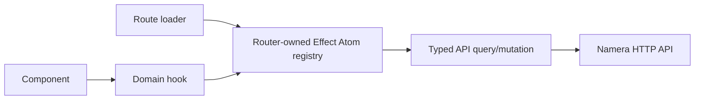

# Dashboard architecture

The dashboard is a Vite/React application using TanStack Router, Effect Atom,
React Hook Form, Tailwind CSS, Motion, Wagmi and `@namera-ai/ui`.

## Queries and authority

Protected loaders prefetch into the same registry observed by rendered hooks.
Query keys and invalidation preserve organization/account scope. Atoms own API
calls and invalidation; hooks expose `onSuccess`, `onError` and `onSettled`.
Components use `mutate` with the shared feedback registry. `mutateAsync` is used
for sequencing, such as serialized autosave.

The pathless `_authenticated` loader resolves the current actor. Only typed
`Unauthorized` becomes a missing actor and redirects to `/auth`; network/server
and decoding failures reach retry feedback. Detail parents validate IDs and
prefetch their data. Query failures use local `DataError` boundaries where the
surrounding shell can remain useful. Feedback never exposes raw exceptions.

Sidebar layouts mark the dashboard shell so route loading, error and not-found
fallbacks retain the bordered page panel and center their feedback inside it.
Nested failures reuse an existing panel rather than adding another main region;
authentication failures outside the shell do not require a sidebar. Rendering
tests cover loading, errors, authentication and nested-panel reuse.

Denied `Unauthorized`/`Forbidden` query results expose no cached data, including
while retrying. Denied queries/mutations refresh current-user authority. Ordinary
network failures retain already-loaded data. The current-user atom revalidates
on document visibility. When user/session/organization/membership/role/permissions
change, the layout unmounts protected content, resets the registry and invalidates
loaders. Profile presentation changes do not reset dirty forms. This is a UI
safeguard; server authorization remains authoritative.

Autosave captures the original authority and checks it before validation and
dispatch, including unmount/pagehide flushes. It cannot cancel a write already
accepted by the server. There is no push channel for remote role changes.

## Product routes

- Sign-in through email or Google, beta-invite admission, invitation review,
  workspace creation, OAuth and CLI consent.
- Organization overview, accounts and account Overview/Assets/Session Keys/Usage.
- Session-key creation, installation/removal and Overview/Policies/Usage.
- Activity and execution detail, and the notification inbox.
- Profile, notification preferences, login sessions, workspace, members,
  invitations, API keys, MCP/CLI authorizations and billing usage.

Overview prefetches `GET /dashboard/overview`. Its namespace-discriminated
response contains resource totals, execution/signature series and execution
source distribution. The current EVM series has daily, weekly and monthly
buckets. When the execution-source distribution is empty, the overview shows
permission-aware quick-action links for account/session-key creation, MCP setup,
API-key management, and member invitations instead of the source chart. Recent executions reuse the Activity table; quota and period consumption
belong to Billing. The billing page presents the Free plan, anniversary date,
resource capacity and settled/reserved meters with permission-aware access.
Free v2 includes separate self-owned and 1Claw-managed account/session capacities.
1Claw account and session-key creation are available. Legacy organizations see the scheduled
Free v2 date from the API; over-limit capacity stays visible without implying
that existing resources were removed. Paid upgrades remain unavailable.

## Account creation and portfolio

Successful account creation opens `/accounts/created/$accountId`, a protected,
refresh-safe next-steps page loaded through the shared wallet atom. It shows the
same account identity and properties as the account overview, followed by a
permission-aware session-key shortcut. The shortcut preselects only an eligible
account from the current workspace's wallet list; invalid or unavailable search
IDs do not select an account. Normal account links still open the overview.

Account creation defaults to 1Claw Managed, followed by User-owned passkey in the
selector; Namera Managed remains last and disabled. Managed creation posts the 1Claw owner variant without a
WebAuthn ceremony and uses the existing success page. Ownership displays show
the provider logo, without an HSM claim. WebAuthn display labels use the account name; the challenge,
user handle and RP ID remain server-issued. No private owner key enters API or
form state. See [accounts](../wallets/accounts.md).

Network installation/removal selects passkey approval or managed prepare/approve
from the parent account, independently of session-key custody. Managed approval
independently reconstructs and validates the operation before an explicit
confirmation dialog. Cancel signs nothing; retry retains the idempotency key,
and signed operations use existing receipt polling. Quota feedback uses the
current subscription response, not hardcoded Free v2 limits. Browser checks
cover ownership selection and fallback layout; live provisioning, encrypted
import and onchain approval still require the configured development environment.

Assets prefetches the account's paginated portfolio into the shared registry and
loads all pages. Token rows display the token icon with a chain badge, balance,
USD price and USD value. The total, chain allocation and asset chart derive from
the same exact-valued response and network visibility filters. Unpriced assets
remain visible and are excluded from USD allocation; small slices group into
Other. The tertiary refresh icon requests a fresh server snapshot and invalidates
the account query. Failures retain the displayed snapshot and show feedback.
All networks are visible by default. The table has no view-options control; its
Chain filter includes every supported mainnet and testnet, grouped by environment,
even when there are no balances. Filters affect table rows, not the portfolio summary.
The server's five-minute cache is independent of frontend query lifetime; see
[portfolio](../evm/portfolio.md) for cache keys, paging and provider limits.

## Session authority and custody

Creation defaults to 1Claw Managed independently of the parent account. The selector
lists 1Claw Managed, User Owned, then disabled Namera Managed (coming soon).
Managed registration validates the returned public identity, permissions and
networks before enabling approval. It skips generation/export/import and proceeds
to network approval; it never downloads provider credentials. Ambiguous errors
block resubmission and direct the user to inspect existing sessions or support.
Members with billing read access cannot select exhausted custody options; the options
show a Limit reached pill, and submission is blocked if the selected custody becomes full.
Quota checks on the server remain authoritative. Custody follows Account in the form;
an inline error explains why Networks/Lifetime alone do not grant access.
Account and session-key pickers omit custody, while account tables default to Ownership
instead of Implementation. Detail and success pages display custody; managed next steps require
login/grants but no import. Namera Managed remains disabled.

### Local keys

Creation presents six capabilities: Contract access, Token spending, Native
spending limit, Gas budget, Signatures and Unrestricted account access. Contract
access covers one contract/all functions, one contract/selected functions, or
selected functions on any contract. Native/gas amounts serialize exact base
units; token allowances use explicit token base units. Budgets are lifetime per
network. The two-step Metadata → Policies flow keeps the same narrow page width.
Canonical form state is `onchain.installations`. The network picker retains existing
entries and adds new entries with no permissions or signature authority. Each network
has its own Lifetime card and inline policy editors. Adding a network never copies
contract addresses, allowances, dates, or signature flags from another network.
Network selection appears below Custody in Metadata; at least one is required to
continue. Policies has a single-network selector scoped to those selections and
shows only that network's cards. Inactive sections stay mounted to preserve editor
metadata, and switching networks is disabled while a policy editor is open.
Add policy opens a searchable, single-column list without categories in a modal;
selecting a policy opens its configuration, and saving adds the card to the page.
Existing cards expand an inline editor beneath their summary. Save collapses the
editor with the updated summary; Cancel discards the draft.
Lifetime and permission edits affect only the section's network.
Edits apply only on Save; cancelling or dismissing leaves the form unchanged.
Submission and step changes are disabled while adding or editing a policy.
Metadata persists when going back.
Creation and the read-only Policies page share policy cards and summaries;
token summaries resolve metadata only for networks carrying that permission.
The detail Policies page uses a “Viewing policies for” selector and renders only
that network's lifetime, permissions, signature authority and approval status,
without policy edit or remove actions. Session-wide API rules remain explicitly
labelled Shared API policies rather than being presented as installation-specific.
Hidden approval rows stay mounted so switching networks does not interrupt receipt
tracking or an in-flight approval. Token summaries expose the full
contract address through a keyboard-accessible info tooltip.
New forms select Ethereum mainnet, start immediately, and expire 30
days after opening the form. Editing dates selects local midnight at the start
of the chosen date. At least one network and an expiry remain required.

Unrestricted account access is added directly from the picker without a separate
confirmation or editor. Its card retains the red full-authority warning and a
remove action. It is exclusive with other transaction permissions.
Limits alone do not grant access. Selecting Signatures adds it immediately with
only Messages enabled and opens its inline editor for signature types and typed-data
rules. Cancel keeps the newly added Messages policy and discards editor changes.
Gas budget and Native spending limit also add directly and open their inline
editors, initially with a zero limit. Cancel preserves that zero-limit policy.
Contract access and Token spending open as inline draft cards instead of modal
forms. Save validates and appends the permission; Cancel discards the draft.
Contract access offers all functions on one contract, selected functions on one
contract, and selected functions on any contract. Address search includes tokens
and contracts on the editor's network. Custom targets inherit that scope and have no network field;
selected-function custom targets collect a JSON ABI. Catalog deployments load
their linked interface through the cached catalog query, with loading/error/retry
states. Missing interfaces and any-contract mode accept a pasted ABI. The shared
function picker uses canonical signatures, then saves deduplicated four-byte
selectors; target/ABI changes clear selections and save checks ABI membership.
Contract editor metadata is retained while the Policies step remains mounted.
Token spending uses a network-scoped picker. Custom tokens require only address
and decimals; their network comes from the containing editor. Allowances apply
only on that network. Saved token metadata is keyed by chain and address.
The creation draft retains saved token selections and decimals outside policy
editors, including when returning to Metadata. Reopening an editor reconstructs
the display amount from stored base units using those decimals. This UI metadata
is not submitted with permissions or persisted across page reloads.
Signatures adds the API rule and
explicit owner-reviewed installation `allowSignatures` together. Signing rules remain
one session-level API policy, shared by networks with signature authority enabled.
Each network opts in independently. Rule pickers offer only enabled signature
networks; disabling/removing a network with rules requires removing those rules first.
Optional EIP-712
rules restrict network, verifying contract, exact domain name/version and primary
types. Omitted rules permit any typed data within the selected signature policy.
API content/expiry restrictions cannot constrain direct local signing; onchain
removal is required to remove installed signature authority.

The SDK draft holds the private scalar in a ref, not in form or API state.
Registration is checked against the original wallet, signer, networks and
permissions before constructing local export bindings. Encrypted export/import
is followed by network approval and then login/grant setup. Pending sessions are
not available to delegated-client selectors. Navigation warns until the local
key is acknowledged as saved. See [local key storage](../clients/local-keystore.md).

After import acknowledgement, the network approval step offers Skip for now (or
Continue once active), opening `/session-keys/created/$sessionKeyId`. This
refresh-safe page reads the shared session atom, shows confirmed network state,
and links to permission-aware MCP/API-key setup. Pending keys retain an enable
networks action; skipping never activates a key.

Approval independently checks the prepared operation against the reviewed
installation before opening WebAuthn. Completion and receipt polling update the
session; no optimistic activation occurs. Public operation lookup recovers after
navigation. API revocation immediately denies delegated use, while onchain
removal proceeds per network and can have partial failures. Installed authority
is read-only; replacing permissions requires a new session.

Paused networks remain visible but cannot receive new sessions or passkey
approvals. Existing signed operations keep polling. Server guards protect stale
browser builds. See [session lifecycle](../wallets/session-keys.md).

## Forms and shared components

### Recipes

`/recipes` is a sidebar destination with a searchable code-defined recipe list;
search includes `display.tags`. `/recipes/$recipeId` is a self-contained creation
page guarded by `session-key:create`, with permission-aware account and billing
prefetch. Unknown recipe IDs use the normal not-found boundary.

The private `packages/recipes` workspace owns metadata under `display`, tags,
versioned definitions, Effect input schemas, typed form descriptors and deterministic
builders. It depends only on protocol and Effect, not the catalog or React. Builders
return current `onchain.installations` and session-level `policies`; they neither
create signers nor submit requests. The first recipe grants a lifetime USDC allowance
independently on selected networks using Circle's native deployments. Amounts are
exact six-decimal base units. A calendar picker selects expiry at local midnight
at the start of the chosen date, serialized as a UTC ISO timestamp; the builder
rejects invalid or elapsed expiry dates. Recipe fields use the same card rows as
metadata. The list uses the members-page width and optional `display.banner` covers.
Signatures remain disabled. There is no cross-chain shared budget or periodic reset.

`components/session-key-creation` is shared by custom creation and recipes. Metadata
and recipe fields appear together; generated permissions pass through the existing
creation resolver before submission. Paused networks are unavailable. The shared
creation hook owns public registration verification, ambiguous-error recovery,
private draft lifetime, duplicate-submission guards and backup navigation blocking.
Recipe creation embeds local encryption/import, managed network approval and the
completion screen without navigating to another setup route. Setup stays mounted
when returning from completion to enable more networks, preserving local backup
acknowledgement and in-flight approvals. Approval uses
the existing independently verified owner-operation path; this feature adds no API,
database table, audit type or signing bypass. Existing creation emits its normal
transactional audit event. Templates and their input values are not persisted.

Package tests cover per-chain addresses, exact amounts, overflow, invalid networks
and expiry; dashboard resolver tests cover both custody variants using generated
recipe permissions. Browser checks do not substitute for live custody or onchain
approval verification.

`components/evm-address-picker` provides a controlled, single-deployment picker
with required `chainIds` (supported CAIP-2 IDs), `types` (`erc20` / `contract`),
`value` and `onChange`. Empty filter arrays disable selection. Catalog selections
are correlated unions of `{ source: "catalog", type, catalog, deployment }`,
inferred from `types`; the full catalog and deployment records are retained.
The base `EvmAddressPicker` is catalog-only. `EvmAddressPickerWithCustom` adds
`{ source: "custom", value: TCustom }`, where custom values include chain/address
and may carry caller-specific fields. Its render callbacks own custom display
and a draft form; confirmation commits, cancellation does not change selection.
`EvmErc20Picker` fixes the catalog type to ERC-20 and requires explicit custom
decimals (integer 0–255). `EvmContractPicker` fixes the type to contract and uses
only chain/address for custom values. Custom entries are not verified onchain.
The dropdown queries only while open, debounces search, preserves server ranking
within each network, and pages 20 parents per network. Its atom uses the existing
authenticated discovery endpoint with at most four concurrent chain requests;
it does not fetch ABI documents. Errors expose retry rather than stale options.
Custom input checks EVM address syntax/checksum and requires an allowed network.
Tests cover custom address/network/decimals validation and catalog/deployment
pairing. Session-key token spending uses `EvmErc20Picker`, restricted to the
session's selected networks. Picker metadata supplies address and decimals;
the form validates network membership again on save and converts the allowance
without rounding. Existing policies store only address/base units, so editing
requires reselecting the token to confirm network/decimals; selecting the same
address preserves its stored base units. Network selection here does not change
the onchain permission contract: that address/allowance still applies on every
session network. Other policy editors are not yet
wired to the picker. Consumers must validate their current filter scope before
submission if the allowed chains/types change after selection.

`components/display/token-display` resolves namespace/chain/address through the
existing authenticated catalog resolve API, sharing cached lookups by normalized
address. It displays token identity and optional exact base-unit amounts using
deployment decimals. Missing metadata retains the address and raw base units;
loading uses skeletons and failed lookups offer retry. Creation's token-spending
cards resolve each selected session network independently, without assuming a
token or its decimals is identical across networks. This does not change policy data.

`components/evm-function-picker` accepts a supplied ABI and controlled single or
multiple canonical-signature values. It makes no network requests. Function-only
options show signatures, mutability and four-byte selectors; overloads retain
separate signature identities. Search matches all three fields. Multi-select
bulk selection adds visible results without dropping hidden selections, while
deselect-all clears the entire selection. Stale values are marked invalid and
must be checked by consumers before saving against a changed ABI. Policy editor
wiring and contract-interface fetching are not part of this component.

Forms use Effect Schema via `Schema.toStandardSchemaV1`, the Standard Schema
React Hook Form resolver, native forms, `Controller` and UIKit fields. Controls
adapt selection/value handlers explicitly. Read-only forms do not autosave or
block navigation. Optional descriptions and missing profile/logo values are
normalized at the form boundary before strict DTO encoding.

Route-only UI stays in `src/routes/**/-components/`. Cross-route components live
in `src/components`, table controls in `components/common/table`, value displays
in `components/display`, and policy editors in `components/policy/evm`.
`@namera-ai/ui` owns shared primitives, semantic styles, icons and hooks. Controls
retain accessible names, keyboard/focus behavior and reduced-motion support.

Tables separate declarative columns from query/view state. Organization,
account and session-scoped execution/session tables share a body while loading
server-scoped records. Revocable resources default to active rows with history
available through filters. Detail pages fetch expanded relations separately.

## MCP setup

Settings provides local CLI stdio setup and authorization management. The agent
launches `namera mcp serve`; browser OAuth consent is separate from CLI device
login and API keys. Imported local keys or server-held 1Claw session keys provide signing. Credentials persist in
the OS keyring across process restarts; see [local MCP](../clients/local-mcp.md).
The setup selector includes Codex, Claude Code and Gemini CLI with
add-server commands. Each uses a distinct
MCP profile. These presets do not imply end-to-end signing verification in every
client. Client logos are locally served SVGs from theSVG with source attribution.

## Browser boundary

Vite preserves browser resolution conditions alongside `namera-source`. Browser
chain metadata and owner review use `@namera-ai/evm/chains` and the lazy
`session-review` entry point, not the server provider/configuration barrel.
Browser OTLP goes only through the server `/t/*` proxy; provider secrets never
enter the bundle. See [telemetry](../platform/telemetry.md).

`tooling/document-security.ts` owns dashboard CSP and document headers. Static
hosts must apply `_headers` or equivalent host configuration; HTML metadata
cannot enforce framing denial or Permissions-Policy. Production permits
first-party WebAuthn, HTTPS external images and connections to the configured
API origin. Development permits HMR.

Route metadata keeps private routes noindex and canonical/social URLs pointed
to `/auth`. Loaded account names affect tab titles only, never social metadata.
Nginx and Vite preview enforce `X-Robots-Tag`. Shared OG/icon assets use the public
CDN; app manifests remain same-origin. The manifest provides no offline cache.
