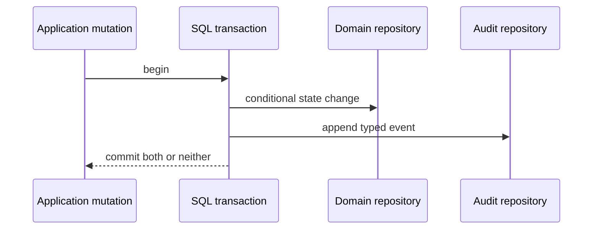

# Audit events

Audit events preserve typed historical context for successful state changes.
They are distinct from logs: audit data is queryable product history, while logs
describe operational transitions.

## Persistence

The `audit.user_events`, `audit.organization_events`, `audit.platform_events`,
`audit.beta_invite_events`, and `audit.waitlist_events` column,
foreign-key, check, and index definitions are in the
[audit database catalog](../database/audit.md).

## Write contract

The internal Audit service adds source and active correlation context. Failed
mutations and reads are not audited. Idempotent no-op mutations do not append a
duplicate event. Current event families cover user/sign-in/session,
organization/member/invitation, wallet, API key, OAuth authorization, session
key, execution, signature, and beta-invite lifecycle transitions. Beta-invite
events retain a separate ID-only journal. Operator mutations also append
platform events attributed to the authenticated platform member in the same
transaction; see [admin authorization](../auth/admin.md). Bootstrap events may
have no acting member.

Events exclude credentials, raw signed content where not required, signatures,
arbitrary provider errors, and complete transaction call payloads.

## Product analytics projection

The Audit service also enqueues explicitly selected product milestones in
`jobs.analytics_jobs` inside the same transaction. This is a projection, not an
export of audit data: only event name, verified actor identity, workspace/resource
IDs, chain, namespace, and bounded lifecycle categories are selected. Credentials,
addresses, signed content, device names, IPs, and user agents are not exported.

HTTP eligibility is set at the server boundary (production token present, no
DNT/GPC/analytics opt-out, no internal route). Background execution and session
installation outcomes require a durable eligibility key from the opted-in prepare
operation; pre-existing and opted-out operations are not backfilled. The actor is
resolved from the persisted membership, not request parameters. A workspace's first
confirmed execution or completed signature queues `workspace_activated` once.

Audit and outbox insertion roll back with the business transaction. The separate
server worker performs provider I/O after commit. Outbox insertion errors remain
database failures; provider outages never fail the business request. Waitlist joins
enqueue directly in their creation transaction and ignore duplicate submissions.
