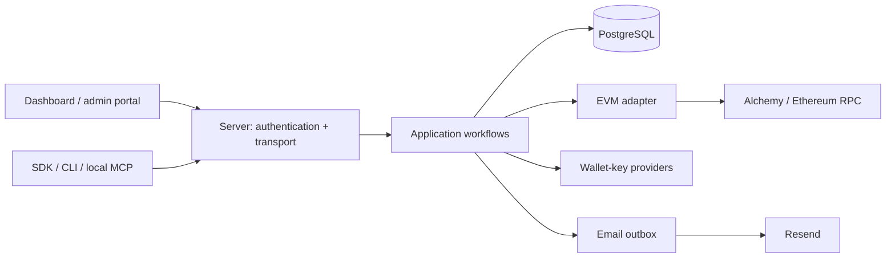

# System model

Namera gives AI agents wallets with permissions built in. A workspace owns
accounts and session keys. People manage those resources through authenticated
browser sessions; applications and agents use explicit session-key grants.

The implemented chain namespace is `eip155`. Accounts are EVM smart accounts;
transaction submission uses ERC-4337. Namespace discriminators in contracts do
not imply that another chain family is implemented.

## Boundaries

| Layer                | Owns                                                                       | Does not own                          |
| -------------------- | -------------------------------------------------------------------------- | ------------------------------------- |
| `protocol`           | Schemas, IDs, DTOs, expected errors                                        | I/O or authorization decisions        |
| `api`                | Typed HTTP contract                                                        | Handlers or business workflows        |
| `apps/server`        | Actor resolution, HTTP policy, handlers, live composition                  | Database query implementations        |
| `application`        | Authorization-dependent workflows, transactions, billing, audit            | HTTP cookies or provider private keys |
| `database`           | Schema, queries, transaction context, migrations                           | HTTP or chain submission              |
| `evm`                | Chain clients, account construction, policies, signing envelopes, receipts | Workspace billing or custody secrets  |
| `wallet-providers/*` | Provider-specific key lifecycle and signing                                | Chain execution or billing            |
| `ui`                 | Shared React presentation and theme                                        | API access or permissions             |

The server supplies runtime layers. Application workflows call explicit provider
services; EVM code receives signing callbacks rather than private key material.
Public packages are `protocol`, `api`, `sdk`, and `cli`. Other workspaces are private.

## Authority

A browser session identifies a user and active workspace membership. Workspace
permissions govern management actions; account-owner actions additionally check
ownership. Platform administration uses separate platform membership.

API keys and OAuth clients do not inherit the creator's complete account access.
They receive scopes and grants to specific session keys. API keys may additionally
receive explicitly issued workspace-wide wallet management permissions, including
creation and owner-approved session installation/removal. These do not replace
execution grants or passkey signatures. The delegated execution
and signing paths check those grants, session lifecycle, installation state, and
applicable policies. Owner transaction/signing endpoints are not delegated APIs.

Onchain permissions and server policies have different trust boundaries. A local
session signer can operate outside Namera; server-side restrictions alone cannot
prevent direct signing. See [policies](wallet-system/policies.md).

## Durable work

Preparation, approval, submission, and confirmation are separate states. The
database stores operation identities, signed requests, attempts, reservations,
and reconciliation scheduling. A timeout or missing receipt is not proof of
failure. Workers reconcile evidence without blindly rebroadcasting uncertain
submissions. See [reconciliation](wallet-system/reconciliation.md).

Business state and its audit/outbox records share a database transaction.
Remote signing, provisioning, and chain submission cannot be rolled back with SQL;
their workflows retain durable identities and recheck authority around those calls.

## Source map

- [Server composition](../apps/server/src)
- [Application services](../packages/application/src)
- [Protocol contracts](../packages/protocol/src)
- [HTTP API](../packages/api/src)
- [Database schema and repositories](../packages/database/src)
- [EVM adapter](../packages/evm/src)
